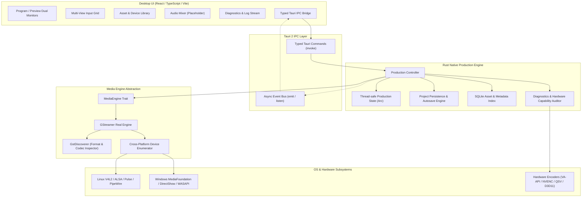

# LiveStudio Pro — Architecture & Technical Design Specification
**Phase 1: Desktop Foundation**

## 1. Executive Summary

LiveStudio Pro is a professional, high-performance, cross-platform desktop live video switcher and media production system built with Tauri 2, Rust, React, TypeScript, and GStreamer. It is architected for Windows as the primary target and Linux as a first-class secondary target.

LiveStudio Pro strictly decouples the user interface from real-time multimedia processing:
- **Frontend (React 18 / TypeScript)**: Focuses exclusively on layout, user interaction, switcher control state, multi-view presentation, and telemetry display. It executes zero video decoding, compositing, or encoding.
- **Native Backend (Rust / Tokio)**: Acts as the production controller, managing state machines, persistence, device discovery, capability auditing, and IPC orchestration.
- **Media Engine (GStreamer 1.28+)**: Executes within independent threads and native pipelines decoupled from the UI rendering cycle. Component unmounts or frontend refreshes cannot disrupt running production pipelines.

---

## 2. System Architecture

---

## 3. Core Subsystems

### 3.1. Desktop UI & Workspace Manager
- Dark broadcast production studio aesthetic with high visual contrast.
- Visual tallies: Green border for **Preview (PVW)**, Red border for **Program (PGM)**.
- Live telemetry: Frame times, CPU load, RAM consumption, engine status.
- Transition block: CUT, AUTO with configurable duration, Fade, interactive T-Bar.
- Clearly labeled placeholders: Zero fake active streams or simulated video.

### 3.2. Typed Command / Event Bridge
- Strongly typed TypeScript interfaces mirroring Rust structs and enums.
- Bidirectional async communication via Tauri 2 command invocation and event subscriptions.
- Structured domain error handling: every error returns `{ code, message, details, actionable_hint }`.

### 3.3. Media Engine Abstraction (`MediaEngine` Trait)
- Real GStreamer initialization (`gst::init()`).
- Media probe and metadata inspection powered by `gst_pbutils::Discoverer`:
  - Validates container formats (MP4, MKV, MOV, TS, WebM, etc.).
  - Extracts duration, video streams, audio streams, codecs, resolutions, framerates, channel layouts, sample rates.
- Minimal real test pipeline capability for pipeline health diagnostics.
- Clear interface for Phase 2 expansion into multi-bus compositing and capture.

### 3.4. Input & Device Manager
- Cross-platform abstraction behind `DeviceEnumerator`.
- Linux: Discovers `/dev/video*` V4L2 devices with capabilities, formats, and resolutions.
- Windows: Uses GStreamer `DeviceMonitor` (supporting MediaFoundation / DirectShow / WASAPI).
- Audio input discovery across ALSA, PulseAudio, PipeWire, and WASAPI.

### 3.5. Project Persistence & Autosave Recovery Service
- Versioned project schema (`schema_version: 1`).
- Atomic JSON writes (`.tmp` -> rename) to avoid file corruption.
- Periodic and dirty-state autosave with recovery file management (`.recovery.json`).
- Crash recovery detection: if an unclean shutdown occurs, user is prompted to restore or discard the recovery state.
- SQLite indexing for imported media assets and metadata cache.

### 3.6. Diagnostics & Capability Detection
- Real-time audit of installed GStreamer plugins:
  - Hardware acceleration: VA-API (`vaapi`), NVIDIA NVENC (`nvcodec`), Intel QuickSync (`qsv`), Direct3D11 (`d3d11`).
  - Video encoders & decoders: x264, openh264, vp8, vp9, av1.
  - Device capture elements: v4l2src, dshowvideosrc, mfvideosrc, pulsesrc, alsasrc, wasapisrc.
- Actionable diagnostics: If a plugin is missing, a specific installation package command is suggested.
- Live resource monitoring via `sysinfo`.
