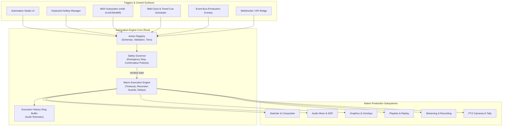

# LiveStudio Pro — Automation Architecture (Phase 9)

## 1. Overview and Core Philosophy

LiveStudio Pro Phase 9 introduces a production-ready, native automation and professional control surface subsystem. 

### Single Source of Truth Principle
All automation actions directly command the native `ProductionController` and underlying engines (`SwitcherController`, `NativeAudioEngine`, `NativeGraphicsEngine`, `PlaybackEngine`, `InstantReplayEngine`, `NativeOutputEngine`, `RemoteProductionEngine`). The automation system is not a detached simulation or a UI-only layer; every macro step, hotkey trigger, and MIDI fader movement operates upon real production pipelines.

---

## 2. Subsystem Architecture

---

## 3. Module Hierarchy & Responsibilities

1. **`action.rs` (Unified Action Registry)**
   - Defines `ActionCategory` (Switcher, Playback, Graphics, Audio, Output, PTZ, Remote, Application).
   - Enforces `ActionSafetyTier` (`ReadOnly`, `PreviewOnly`, `ProgramAffecting`, `OutputAffecting`, `Destructive`).
   - Validates parameter schemas, ranges, allowed enum options, and required arguments before execution.

2. **`macro_engine.rs` (Deterministic Macro Sequencer)**
   - Handles sequential execution of multi-step macros with deterministic ordering.
   - Per-step and global timeouts using `tokio::time::timeout`.
   - Cancellation token architecture allowing immediate abortion of long-running delays.
   - Enforces strict recursion limits (`MAX_RECURSION_DEPTH = 5`) and loop bounds (`MAX_LOOP_ITERATIONS = 50`) to eliminate infinite recursive freezes.
   - Implements configurable failure policies: `StopOnFailure`, `Continue`, and `RunCleanup`.

3. **`safety.rs` (Automation Safety Governor)**
   - Implements the global operator Emergency Stop (`trip_emergency_stop()`, `reset_emergency_stop()`).
   - Validates live stream safety rules (prevents accidental stream terminations or high-risk takes during live broadcasts).
   - Manages operator confirmation policies for sensitive actions.

4. **`hotkeys.rs` (Keyboard Shortcut Subsystem)**
   - Key combination parsing (e.g., `Ctrl+Shift+1`, `Space`, `Enter`, `F1-F12`).
   - Normalization and real-time conflict detection (colliding shortcuts are flagged and rejected).
   - Scoped hotkey execution (`global`, `switcher`, `audio`).

5. **`midi.rs` (Physical Hardware Surface Bridge)**
   - Native device enumeration using `midir = "0.10"`.
   - Real-time Note On/Off and Control Change (CC) parsing.
   - Fader value normalization mapping 7-bit MIDI CC (0..127) to decibel gain (-60 dB to +6 dB).
   - Interactive MIDI Learn mode for rapid hardware mapping.

6. **`scheduler.rs` (Timed Cue Scheduler)**
   - Wall-clock, calendar, recurring interval, and daily scheduling.
   - Startup reconciliation of past-due cues with policies: `Skip`, `ExecuteImmediately`, and `NotifyOperator`.

7. **`event_bus.rs` (Production Event Bus)**
   - Emits asynchronous broadcast notifications on state changes (`StreamStarted`, `TransitionCompleted`, `PlaybackEnded`, etc.).
   - Throttling and cooldown enforcement preventing event-action cascades and loop recursion.

8. **`control_surfaces.rs` (Surface State Feedback)**
   - Computes state feedback payloads for hardware controllers and Stream Decks (tally color, mute state, live stream indicators).
