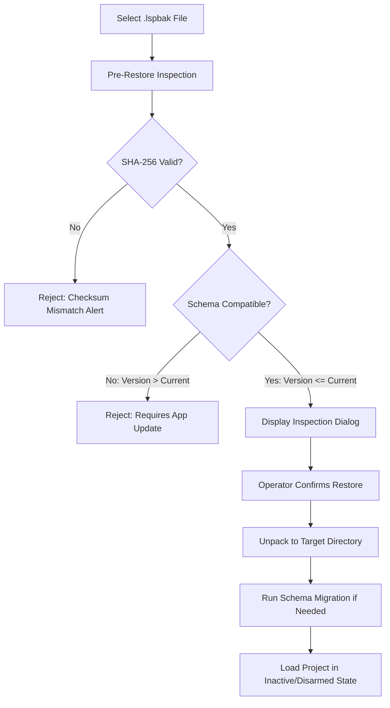

# LiveStudio Pro — Backup & Restoration Guide

LiveStudio Pro provides a robust, self-verifying backup and disaster recovery subsystem designed to protect complete broadcast productions, complex scene switchboard configurations, audio routing graphs, and automation cues.

---

## 1. Backup Architecture (`.lspbak`)

LiveStudio Pro backups are packaged as standardized, gzipped tar archives (`.lspbak` or `.tar.gz`) containing:
1. `manifest.json`: Cryptographic integrity metadata, application schema version, timestamp, asset catalog, and SHA-256 digests.
2. `project.json`: The full serialized project state (Schema Version 11).
3. `assets/`: Optional bundled media, graphics, HTML/CSS templates, and LUT profiles.

### 1.1 Manifest Specification
```json
{
  "backup_id": "bak-9a8f2c3d",
  "project_name": "Evening Broadcast 8PM",
  "app_version": "1.0.0-rc1",
  "schema_version": 11,
  "created_at": "2026-10-22T12:00:00Z",
  "total_assets": 8,
  "total_bytes": 104857600,
  "sha256_checksum": "7c8e9b0a1d2e3f4a5b6c7d8e9f0a1b2c3d4e5f6a7b8c9d0e1f2a3b4c5d6e7f8a",
  "includes_media": true
}
```

---

## 2. Creating a Verified Backup

Backups can be triggered manually via the UI (**File -> Backup & Storage -> Create Backup**) or programmatically via Tauri IPC:

### Operator Workflow
1. Navigate to **Backup & Storage** in the application status bar or menu.
2. Under **Project Backup**, select whether to include referenced media files (or only configuration & templates).
3. Choose the destination directory (e.g., local backup disk, external USB drive, or NAS share).
4. Click **Create Verified Backup (.lspbak)**.
5. The `BackupManager` executes:
   - Atomic flush of the current project in memory to temporary storage.
   - Packaging of the project file and selected assets into a compressed tarball.
   - Calculation and insertion of canonical SHA-256 digests.
   - Verification of the newly created archive by performing a test unpack and checksum comparison.

---

## 3. Pre-Restore Inspection & Safety Verification

Before any archive is restored, LiveStudio Pro performs a **non-destructive pre-restore inspection**:
- Verifies the archive's internal structure and SHA-256 checksum against its manifest.
- Validates the project schema version.
- Displays a detailed inspection summary to the operator:
  - Project name & creation date.
  - Source application version and schema level.
  - Number of assets bundled.
  - Compressed vs. uncompressed size.
  - Checksum validation status (`VERIFIED` vs `CORRUPTED`).



---

## 4. Restoring a Project Safely

When an operator confirms the restoration:
1. **Target Directory Containment**: Files are unpacked exclusively within the selected target directory. Existing projects are never silently overwritten without an explicit prompt.
2. **Disarmed Macro Security**: Imported macros, scheduled triggers, and automation cues are loaded in a **disarmed state**. No network requests, switcher transitions, or hardware commands will fire automatically upon restoration.
3. **Missing Media Resolution**: If external media paths do not match the current workstation, the application automatically offers to open the **Media Relinking Tool** to locate assets across local or networked drives.
