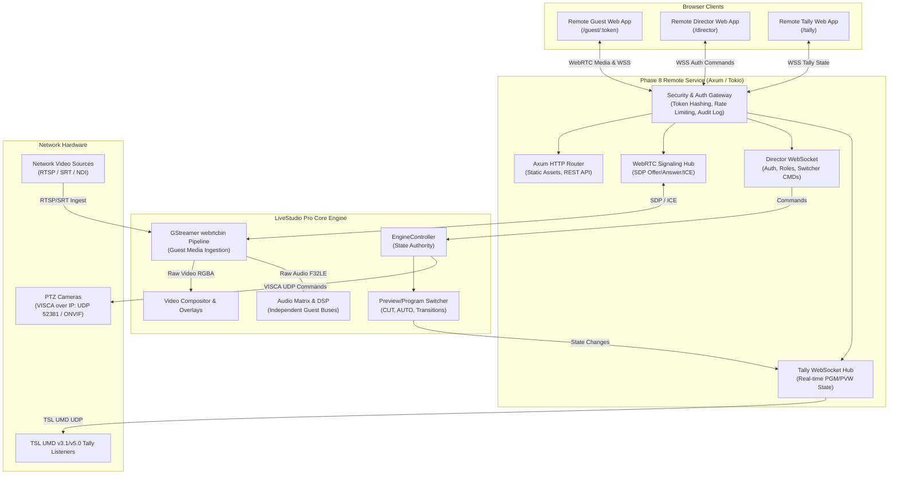

# LiveStudio Pro — Phase 8 Repository & Architectural Audit

## 1. Executive Summary

Phase 8 introduces **Remote Production, Guest Contributions, PTZ Camera Control, Tally Signaling, and Remote Director Control** to LiveStudio Pro. This document provides a comprehensive audit of the application's current architecture (Phases 1–7) and specifies the integration boundaries, dependency map, and security model for Phase 8.

---

## 2. Subsystem Audit (Phases 1–7)

### 2.1 Frontend Framework & Application Structure
- **Framework:** React 19, TypeScript 5, Vite 6, Tailwind CSS.
- **Entry Points:** `src/main.tsx` mounts `src/App.tsx` wrapped in `ProductionProvider`.
- **Workspaces & Views:** Tab/modal-based interface with dedicated panels:
  - Video Switcher (Preview/Program bus, transitions, multicam multiview).
  - Audio Mixer (Master, Program, Preview, Aux, Monitor buses, per-channel faders, EQ/compressor/gate).
  - Media Library & Playback (Media assets, playlists, cue points, instant replay).
  - Graphics & Overlays (Lower thirds, scoreboards, bugs, tickers).
  - Output Manager (Streaming RTMP/SRT, multi-track recording, NDI/virtual camera).
  - Settings & Diagnostics (Hardware acceleration, engine health, system resources).
- **Communication:** Typed Tauri IPC invoke wrappers in `src/services/api.ts` communicating with Tauri Rust commands.

### 2.2 Tauri 2 & Native Rust Backend Architecture
- **Framework:** Tauri v2.12 (`tauri` crate) with native multi-threaded async runtime powered by Tokio 1.43.
- **Engine Core:** `src-tauri/src/core/controller.rs` hosts `EngineController`, the single source of truth managing production state, inputs, audio buses, recording, streaming, and graphics.
- **State Synchronization:** Atomic locks (`parking_lot::RwLock`, `Arc<Mutex>`) and cross-thread messaging between Tokio async tasks and GLib main loops.

### 2.3 GStreamer Media Pipelines & Source Lifecycle
- **Version:** GStreamer 1.28.7 with plugins base, good, bad, and ugly (`gstreamer`, `gstreamer-app`, `gstreamer-video`, `gstreamer-audio`).
- **Source Pipeline Abstraction:** `src-tauri/src/media/pipeline.rs` manages native pipelines (`MediaPipeline`) decoding sources into `appsink` with standard raw video (`video/x-raw, format=RGBA, framerate=30/1, 60/1`) and audio (`audio/x-raw, format=F32LE, rate=48000, channels=2`).
- **Dynamic Attachment:** Sources dynamically attach to the compositor and audio routing matrix via pad linking and bus watches.
- **WebRTC Ingestion:** GStreamer `webrtcbin` is fully verified and available on the system.

### 2.4 Preview/Program Switcher & Compositor
- **Switcher Engine:** `src-tauri/src/switcher/engine.rs` manages Preview and Program buses with zero-frame latency cut, crossfades, wipes, and DVE picture-in-picture transitions.
- **Compositor:** Multi-layer compositor blending background, active Program source, graphics overlays, and DVE layout coordinates.
- **Tally Authority:** Native switcher state is the sole authority on tally status (Program, Preview, Inactive).

### 2.5 Audio Routing, Streaming, Recording & Replay Subsystems
- **Audio Matrix:** `src-tauri/src/audio/engine.rs` routes inputs to Master, Program, Monitor, and Aux buses with per-channel processing (gain, EQ, compression, limiter).
- **Streaming Service:** `src-tauri/src/output/stream.rs` manages RTMP and SRT encoders with reconnect strategies and bitrate monitors.
- **Recording Service:** `src-tauri/src/output/record.rs` records Program, clean feed, or ISO inputs into MP4/MKV with rolling chunk support.
- **Replay Service:** `src-tauri/src/playback/replay.rs` and `src-tauri/src/playback/engine.rs` handle clip ingest, cue points, variable speed replay, and stinger transitions.

### 2.6 Existing REST / WebSocket / Network Services
- **Status Prior to Phase 8:** None. The application operated purely as a local desktop process via Tauri IPC.
- **Phase 8 Addition:** Asynchronous Axum 0.8 HTTP & WebSocket server running inside the Rust backend on Tokio, bound to `127.0.0.1:8088` by default.

### 2.7 Project Persistence & Schema Migration
- **Persistence:** `src-tauri/src/project/manager.rs` and `src-tauri/src/project/model.rs`.
- **Current Schema:** Schema Version 7 (Phase 7 Playback, Playlists, Replay).
- **Phase 8 Target:** Bump to `CURRENT_SCHEMA_VERSION = 8` adding `RemoteProductionConfig`, `PtzCameraConfig`, `PtzPreset`, `NetworkSourceProfile`, and `TallyMappingConfig` with backward-compatible migrations.

---

## 3. Remote Production Dependency Map

---

## 4. Security Architecture & Boundary Analysis

| Security Area | Implementation Status | Deployment Responsibility |
| :--- | :--- | :--- |
| **Network Interface Binding** | Loopback (`127.0.0.1`) by default. Requires explicit operator toggle to bind `0.0.0.0`. | Desktop Application Backend |
| **Authentication & Tokens** | High-entropy cryptographic tokens (UUIDv4 + SHA-256 hash storage), configurable expiration (1h to 24h), instantaneous revocation. | Desktop Application Backend |
| **Role-Based Access Control** | Strictly partitioned roles: `Viewer` (read-only tally/status), `Operator` (switcher/audio control), `Admin` (full system settings). | Desktop Application Backend |
| **Rate Limiting & DoS Guard** | Token-bucket rate limiter per IP, maximum payload size limits (64KB for WS messages). | Desktop Application Backend |
| **Local File & Command Isolation** | Zero filesystem exposure to browser clients; all file paths remain sandboxed inside desktop process. | Desktop Application Backend |
| **Audit Logging** | In-memory and persistent structured audit event logs recording all connections, authentications, failures, and commands. | Desktop Application Backend |
| **TLS / HTTPS / WSS** | Self-signed or custom certificate support for LAN; reverse proxy (Caddy / Nginx / Cloudflare Tunnel) recommended for public WAN. | Infrastructure / Operator |
| **NAT Traversal (STUN/TURN)** | Configurable STUN/TURN ICE server array for WebRTC connectivity through symmetric NATs. | Infrastructure / Operator |
