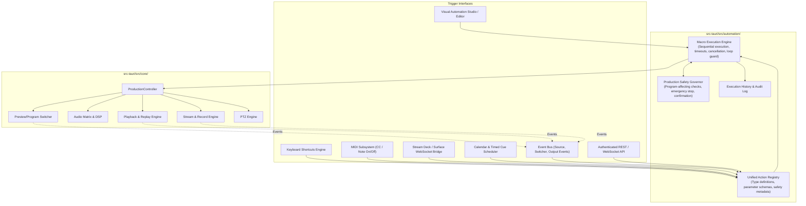

# LiveStudio Pro — Phase 9 Repository & Architectural Audit

## 1. Executive Summary

Phase 9 introduces **Advanced Automation, Multi-Step Macros, Configurable Hotkeys, MIDI Integration, Control Surface Bridges, Event-Driven Triggers, and Timed Scheduling** into LiveStudio Pro. This audit analyzes the existing architecture (Phases 1–8), maps existing native operations that can be automated, and defines the integration architecture.

---

## 2. Inventory of Automatable Native Operations

Every automation action in Phase 9 MUST execute actual native production code in `ProductionController`. Below is the audit of native methods available for orchestration:

| Subsystem | Existing Controller Method | Parameters & Return | Program Affecting? | Reversible? |
| :--- | :--- | :--- | :--- | :--- |
| **Switcher** | `set_preview(input_id)` | `Option<String>` -> `ProjectFile` | No (Preview only) | Yes |
| **Switcher** | `set_program(input_id)` | `Option<String>` -> `ProjectFile` | **Yes (Direct Cut)** | Yes |
| **Switcher** | `cut()` | None -> `ProjectFile` | **Yes (Cut)** | Yes |
| **Switcher** | `auto_transition(duration_ms)` | `Option<u32>` -> `ProjectFile` | **Yes (Transition)** | Yes |
| **Switcher** | `set_transition_type(t)` | `TransitionType` -> `()` | No (Preview state) | Yes |
| **Switcher** | `set_preview_scene(id)` | `Option<String>` -> `ProjectFile` | No (Preview only) | Yes |
| **Switcher** | `set_program_scene(id)` | `Option<String>` -> `ProjectFile` | **Yes (Scene Cut)** | Yes |
| **Media / Playback** | `input_play(id)` | `&str` -> `Result<(), LiveStudioError>` | If source is PGM | Yes |
| **Media / Playback** | `input_pause(id)` | `&str` -> `Result<(), LiveStudioError>` | If source is PGM | Yes |
| **Media / Playback** | `input_seek(id, pos_ms)` | `&str, u64` -> `Result<(), LiveStudioError>` | If source is PGM | Yes |
| **Playlists** | `playlist_play_item(pl_id, idx)` | `&str, usize` -> `Result<(), LiveStudioError>`| If playlist is PGM | Yes |
| **Playlists** | `playlist_next(pl_id)` | `&str` -> `Result<(), LiveStudioError>` | If playlist is PGM | Yes |
| **Playlists** | `playlist_previous(pl_id)` | `&str` -> `Result<(), LiveStudioError>` | If playlist is PGM | Yes |
| **Instant Replay** | `replay_mark_quick_clip(name, src, dur, spd)` | `&str, &str, u64, f32` -> `ReplayClip` | No (Captures buffer)| No |
| **Instant Replay** | `replay_take_live(clip_id)` | `&str` -> `Result<(), LiveStudioError>` | **Yes (Replay PGM)** | Yes |
| **Instant Replay** | `replay_return_to_live()` | None -> `Result<(), LiveStudioError>` | **Yes (Live PGM)** | Yes |
| **Audio** | `audio_engine.set_fader(ch, db)` | `&str, f32` -> `()` | **Yes (Live audio)** | Yes |
| **Audio** | `audio_engine.set_muted(ch, muted)` | `&str, bool` -> `()` | **Yes (Live audio)** | Yes |
| **Graphics** | `graphics_engine.take_overlay_on_air(ch)` | `usize` -> `()` | **Yes (Visual overlay)**| Yes |
| **Graphics** | `graphics_engine.take_overlay_off_air(ch)`| `usize` -> `()` | **Yes (Visual overlay)**| Yes |
| **Graphics** | `graphics_engine.update_item_fields(id, fields)` | `&str, HashMap` -> `()` | If overlay is on-air | Yes |
| **Output** | `start_stream()` / `stop_stream()` | None -> `Result<(), LiveStudioError>` | **Yes (Output stream)**| Yes |
| **Output** | `start_recording()` / `stop_recording()` | None -> `Result<(), LiveStudioError>` | **Yes (Disk recording)**| Yes |
| **PTZ** | `ptz_move(cam_id, dir, p, t)` | `&str, PtzDirection, u8, u8` -> `Result` | If camera is on-air | Yes |
| **PTZ** | `ptz_preset(cam_id, id, action)` | `&str, u32, &str` -> `Result` | If camera is on-air | Yes |

---

## 3. Dependency Map

---

## 4. Safety Classification Matrix

| Action Safety Tier | Classification Rules | Enforcement Policy |
| :--- | :--- | :--- |
| **Tier 1: Read-Only** | Queries status, reads tally, reads meters, inspects inputs. | Auto-approved in all profiles. No confirmation needed. |
| **Tier 2: Preview-Only** | Cues sources to Preview bus, changes multiview layouts, adjusts preview audio monitors. | Auto-approved. Safe during live broadcasts. |
| **Tier 3: Program-Affecting** | CUT, AUTO, Take Replay, Show Overlay, Adjust PGM Audio Fader, PTZ movement. | Permitted in macros; flagged with visual warnings in editor; respects Emergency Stop. |
| **Tier 4: Output-Affecting** | Start/Stop Streaming, Start/Stop Recording. | Configurable confirmation requirement in production profile to prevent accidental air disruption. |
| **Tier 5: System Admin** | Server network rebind, token modification, project schema alterations. | Requires Administrator role permission. |
