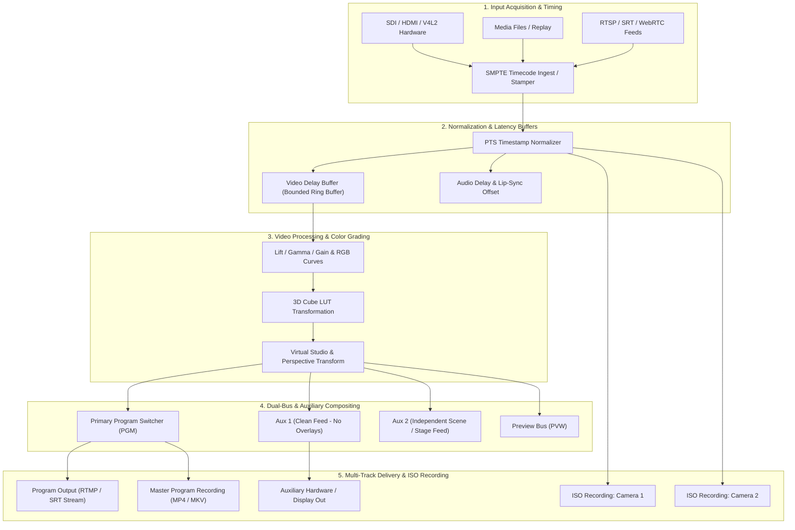

# LiveStudio Pro — Professional Media Pipeline & Broadcast Architecture (Phase 10)

## 1. Overview and Core Tenets

Phase 10 upgrades LiveStudio Pro into a broadcast-grade media infrastructure. The architecture adheres to five core tenets:
1. **Separation of Concerns:** Acquisition, clocking, synchronization, processing, compositing, encoding, and delivery operate through decoupled, bounded stages.
2. **True Independent Outputs:** Auxiliary outputs, clean feeds, and secondary program outputs run on isolated pipelines so that a failure in one destination never crashes primary Program broadcast.
3. **Multi-Camera ISO Recording:** Individual source streams record concurrently with Program recording using dedicated pipeline tap points and resource safeguards.
4. **Honest Capability Discovery:** Professional hardware (SDI, Genlock, Timecode, DeckLink) is queried dynamically; absent hardware or uninstalled SDKs are clearly reported as unavailable or unverified rather than simulated.
5. **Deterministic Timing & Synchronization:** Software clock alignment, presentation timestamps (PTS), and SMPTE timecodes are rigorously delineated from physical hardware genlock.

---

## 2. Professional Media Pipeline Architecture

---

## 3. Subsystem Breakdown

### 3.1 Input Acquisition & Timing
- Sources register with the centralized engine with unique, stable IDs.
- Timecode metadata is captured directly from LTC/SMPTE input or generated via master production clock.
- Clock drift is tracked and bounded buffers absorb packet jitter.

### 3.2 Multi-Camera ISO Recording
- Sources selected for ISO recording tap uncompressed frames before downstream switcher transitions.
- Independent GStreamer encoding pipelines (`appsrc ! videoconvert ! x264enc/nvcodec ! mp4mux ! filesink`) record each camera stream.
- Per-source status, duration, file size, frame drops, and bitrates are monitored in real time.
- Resource governor calculates disk write throughput and GPU encoder session limits before recording starts.

### 3.3 Auxiliary Outputs & Clean Feeds
- Auxiliary outputs allow routing:
  - `Program`: Exact mirror of live output.
  - `CleanFeed`: Program scene stripped of overlay graphics (for international/clean broadcast distribution).
  - `AuxScene`: Distinct composition scene independent of Program.
  - `IsolatedSource`: Direct pass-through of a specific camera input.
  - `PreviewMonitor`: Dedicated external monitor output showing Preview bus.

### 3.4 Professional Color Management
- 3-way color correction: Lift (shadows), Gamma (midtones), Gain (highlights).
- Temperature (warm/cool) and Tint (green/magenta) white balance controls.
- 1D/3D `.cube` LUT file parsing, validation, and real-time application.
- GPU acceleration where available; safe software conversion fallback.

### 3.5 Bounded Delay Buffers & Lip-Sync Offset
- Video delay buffer: Circular frame queue configured from 0 to 5000 ms.
- Audio delay buffer: Millisecond-precision audio delay applied per channel or bus to eliminate audio-video skew.
- Resource guard limits memory consumption to prevent out-of-memory panics.

### 3.6 Virtual Studio & Perspective Projection
- Chroma keying engine with spill suppression and matte feathering.
- Quadrilateral corner pinning for placing virtual video screens on angled walls or perspective displays.
- Layered scene compositing preserving alpha transparency.
