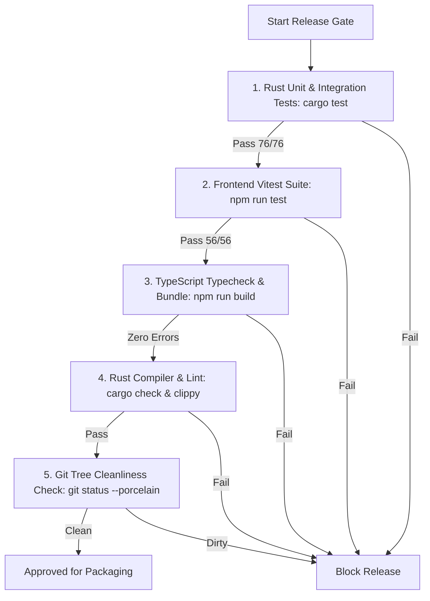

# LiveStudio Pro — Release Process, Versioning & Packaging Pipeline

This document outlines the standard engineering release process for LiveStudio Pro, covering versioning conventions, automated verification gates, cross-platform packaging, artifact signing, and deployment procedures.

---

## 1. Versioning Conventions

LiveStudio Pro strictly adheres to [Semantic Versioning 2.0.0](https://semver.org/):
```
MAJOR . MINOR . PATCH [ - PRERELEASE ]
```
- **MAJOR**: Incompatible schema upgrades, fundamental API changes, or major architectural overhauls.
- **MINOR**: New broadcast production features, new hardware backend drivers, backward-compatible schema enhancements.
- **PATCH**: Backward-compatible bug fixes, security patches, performance optimizations.
- **PRERELEASE**: Pre-production release candidates (`-rc1`, `-rc2`) or developer betas (`-beta1`).

### Tri-File Version Synchronization
Every release must maintain identical version numbers across the three primary application configuration files:
1. `package.json` (`"version": "1.0.0-rc1"`)
2. `src-tauri/Cargo.toml` (`version = "1.0.0-rc1"`)
3. `src-tauri/tauri.conf.json` (`"version": "1.0.0-rc1"`)

---

## 2. Pre-Release Verification Gates

Before cutting any release branch or triggering binary artifact builds, the following verification gates must pass cleanly with zero warnings/errors:



### Verification Commands
```bash
# 1. Rust test suite
cargo test --verbose

# 2. Frontend test suite (Node >= 20)
npm run test -- --run

# 3. TypeScript compilation
npm run build

# 4. Cargo static analysis
cargo check
cargo clippy --all-targets -- -D warnings
```

---

## 3. Cross-Platform Packaging Pipeline

### 3.1 Linux Bundle Generation
On an Ubuntu 22.04 or 24.04 build worker with GStreamer and WebKit2GTK dev libraries installed:

```bash
# Build production Debian package (.deb) and AppImage
npm run tauri build -- --bundles deb,appimage
```
Generated artifacts are located in:
- `src-tauri/target/release/bundle/deb/livestudiopro_1.0.0-rc1_amd64.deb`
- `src-tauri/target/release/bundle/appimage/LiveStudioPro_1.0.0-rc1_amd64.AppImage`

### 3.2 Windows Bundle Generation
On a Windows 11 / Windows Server build runner with Visual Studio Build Tools, Rust MSVC toolchain, and NSIS 3.0+ installed:

```powershell
# Build production NSIS installer (.exe)
npm run tauri build -- --bundles nsis
```
Generated artifacts are located in:
- `src-tauri\target\release\bundle\nsis\LiveStudioPro_1.0.0-rc1_x64-setup.exe`

---

## 4. Cryptographic Signing & Checksum Generation

### 4.1 Windows Authenticode Signing
Windows installers and the main executable must be signed using an EV (Extended Validation) Code Signing Certificate to eliminate SmartScreen security warnings:
```powershell
signtool sign /tr http://timestamp.digicert.com /td sha256 /fd sha256 /a "LiveStudioPro_1.0.0-rc1_x64-setup.exe"
```

### 4.2 Linux Package GPG Signing
Sign Debian packages and AppImages using the official LiveStudio Pro Release GPG key:
```bash
gpg --armor --detach-sign LiveStudioPro_1.0.0-rc1_amd64.AppImage
gpg --armor --detach-sign livestudiopro_1.0.0-rc1_amd64.deb
```

### 4.3 SHA-256 Digest Manifest Generation
Compute canonical SHA-256 checksums for all release binaries:
```bash
sha256sum livestudiopro_1.0.0-rc1_amd64.deb LiveStudioPro_1.0.0-rc1_amd64.AppImage LiveStudioPro_1.0.0-rc1_x64-setup.exe > SHA256SUMS
```

---

## 5. Deployment & Release Publishing

1. **Tag Release in Git**:
   ```bash
   git tag -a v1.0.0-rc1 -m "LiveStudio Pro Release Candidate 1"
   git push origin v1.0.0-rc1
   ```
2. **Publish GitHub Release**:
   Upload all generated installers, standalone binaries, `.asc` signatures, and `SHA256SUMS`.
3. **Update Remote Release Manifest**:
   Update `latest.json` on the release web server with the new version, download URLs, SHA-256 hashes, and changelog notes.
4. **Smoke Test Staging**:
   Download the installer from the public URL on a clean reference Windows and Linux workstation. Verify:
   - Clean installation without administrative permission errors.
   - Initial launch passes System Compatibility Audit.
   - Audio and video hardware detect correctly.
   - Test recording and streaming start and stop safely.
