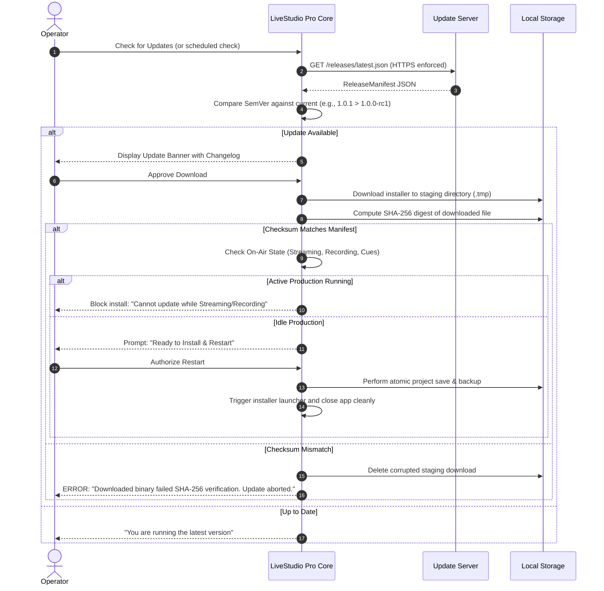

# LiveStudio Pro — Update Architecture, Verification & Rollback Guide

LiveStudio Pro is designed for high-availability live broadcast environments where uncontrolled or spontaneous updates during production could cause disastrous on-air disruptions. This document details the update checking architecture, cryptographic integrity verification, on-air protection locks, and rollback procedures.

---

## 1. Update Architecture Principles

1. **No Silent In-Flight Updates**: LiveStudio Pro will NEVER automatically download, restart, or modify executable binaries while an operator is on-air, streaming, recording, or running automation cues.
2. **Operator Sovereignty**: The operator must explicitly initiate update checks, view release changelogs, review breaking changes, and authorize the installation.
3. **Cryptographic Integrity**: All updates must be delivered over TLS/HTTPS and cryptographically validated via SHA-256 checksums matching the signed release manifest before execution.
4. **Clean Rollback Guarantee**: Project file backups and previous installer archives are preserved to enable immediate rollbacks if regression occurs.

---

## 2. Release Manifest Structure

The application queries an HTTPS endpoint returning a signed JSON release manifest:

```json
{
  "version": "1.0.1",
  "release_date": "2026-11-15T10:00:00Z",
  "min_app_version": "1.0.0-rc1",
  "download_url": "https://releases.livestudiopro.com/v1.0.1/LiveStudioPro_1.0.1_amd64.AppImage",
  "sha256_checksum": "a8f5c2d3e4b5...64hexchars...",
  "changelog": "- Hardened NDI 6 source discovery\n- Fixed audio limiter release timing on high sample rates\n- Added support for Blackmagic DeckLink 8K Pro G2",
  "critical_security_patch": false
}
```

### Manifest Fields
- `version`: Target semantic version.
- `release_date`: ISO-8601 release timestamp.
- `min_app_version`: Lowest version capable of direct upgrade without intermediate migration.
- `download_url`: HTTPS download location for the platform-specific installer or package.
- `sha256_checksum`: 64-character lowercase hexadecimal SHA-256 digest of the release file.
- `changelog`: Operator-facing release notes.
- `critical_security_patch`: Flag indicating urgent security or memory safety resolution.

---

## 3. Verification Workflow



---

## 4. Broadcast Safety Locks

The `UpdateManager` directly queries the `LifecycleManager` and `ProductionController` before allowing an installer to launch:
- If `is_streaming == true` -> Update action is disabled.
- If `is_recording == true` -> Update action is disabled.
- If `is_iso_recording == true` -> Update action is disabled.
- If `has_active_guests == true` -> Warning shown indicating remote WebRTC callers will be disconnected.

---

## 5. Rollback Procedures

If an upgraded version introduces unexpected hardware driver conflicts, SDI capture incompatibilities, or third-party plugin regressions, use the following rollback procedure.

### Step 1: Export Current Project State & Diagnostics
Before downgrading, open **Help -> Diagnostics** and export a diagnostic bundle (`livestudio_diag_*.tar.gz`) along with an atomic project backup (`.lspbak`).

### Step 2: Uninstall the Problematic Build
- **Linux (Debian/Ubuntu)**:
  ```bash
  sudo apt-get remove livestudiopro
  ```
- **Linux (AppImage)**:
  Simply delete or unbind the newer AppImage file.
- **Windows**:
  Open **Settings -> Apps -> Installed Apps**, select LiveStudio Pro, and click **Uninstall** (or run `uninst.exe` from `C:\Program Files\LiveStudioPro\`).

### Step 3: Reinstall the Previous Stable Build
- **Linux (Debian/Ubuntu)**:
  ```bash
  sudo dpkg -i livestudiopro_1.0.0-rc1_amd64.deb
  ```
- **Linux (AppImage)**:
  Make the previous AppImage executable (`chmod +x LiveStudioPro_1.0.0-rc1_amd64.AppImage`) and launch.
- **Windows**:
  Run `LiveStudioPro_1.0.0-rc1_x64-setup.exe` and follow the NSIS setup wizard.

### Step 4: Restore Project Configuration
If the newer release updated the project schema version:
1. Launch the rolled-back LiveStudio Pro version.
2. If an "Unsupported Project Schema Version" message appears, navigate to **File -> Backup & Storage -> Restore Backup**.
3. Select the pre-upgrade `.lspbak` or `.bak_<timestamp>` archive created before the upgrade was applied.
4. Confirm restoration. The project will load in its verified stable schema format.
