# LiveStudio Pro — vMix Parity Dependency Graph & Technical Architecture

**Audit Date:** October 23, 2026  
**Baseline:** LiveStudio Pro `v1.0.0-rc1` vs. vMix 27 / 28

---

## 1. End-to-End Subsystem Dependency Graph

The diagram below maps the verified foundation (Phases 1–11) and the exact technical dependencies required to close all 46 partially implemented, 10 UI-only/placeholder, and 1 SDK-blocked features across Phases 12A–12E.

```mermaid
flowchart TD
    subgraph VerifiedCore ["Verified Core Foundation (57/114 Features)"]
        C_IN["MediaEngine & DeviceEnumerator (media/input.rs, device/*.rs)"]
        C_SW["SwitcherController & SceneCompositor (switcher/*.rs)"]
        C_OUT["OutputEngine Frame/Audio Feeder (output/engine.rs)"]
        C_AUD["NativeAudioEngine Strips, EQ & AFV (audio/engine.rs)"]
        C_GFX["NativeGraphicsEngine & SVG Renderer (graphics/*.rs)"]
        C_REM["Axum RemoteServer, PTZ & TSL Tally (remote/*.rs)"]
        C_AUT["AutomationEngine, Macros & Safety Governor (automation/*.rs)"]
        C_PRJ["SQLite DB, Atomic Save & Crash Recovery (project/*.rs)"]
    end

    subgraph Phase12A ["Phase 12A: Live Pipeline Wiring (P0 Critical Path)"]
        P12A_AUD["Multi-Channel Audio Bus Summing + AudioCapture appsink (AUD-002/003/005, IN-014)"]
        P12A_OUT["Full Mix Audio in RTMP & MP4/MKV Outputs (OUT-001, OUT-004)"]
        P12A_FEED["ISO & Aux 1-4 Live Frame Feeder Threads (OUT-005, OUT-007, OUT-009, OUT-010)"]
        P12A_COMP["Live Compositor Hookup: Chroma Key, Quad Warp, Color Grade, 3D LUT, Delay (SW-010/011, BRO-002/003/004)"]
        P12A_RPL["Live Replay Ingestion, Slow-Mo Program Playout & Pipe Export (PLY-006..009)"]
        P12A_CMD["Remote Director Command Receiver & EventBus Auto-Emit (REM-008, AUT-003/006/011, PLY-005)"]
    end

    subgraph Phase12B ["Phase 12B: WebRTC, Sub-Mixes, Motion/Stinger & Web Inputs (P0/P1)"]
        P12B_WRTC["Real GStreamer webrtcbin SDP/ICE + Mix-Minus & Video Return (REM-001/002/003/010)"]
        P12B_SUB["Sub-Mixes 2-16 Tauri Commands, Compositing & UI (SW-009)"]
        P12B_TRN["Spatial Zoom, Scene Merge & Alpha Video Stinger Transitions (SW-003, SW-004)"]
        P12B_WEB["Offscreen WebKit/CEF HTML Input & Cloud Web Overlays (IN-009, GFX-008)"]
        P12B_DAT["Data Sources UI & Auto-Poll Timer (GFX-003)"]
        P12B_MID["Live midir Hardware Listener & Companion Surface API (AUT-004, AUT-005)"]
        P12B_MON["Native Multi-Monitor Fullscreen Output & Workspaces (SW-007, REL-012)"]
    end

    subgraph Phase12C ["Phase 12C: Hardware SDI, NDI 6 & Pro Audio Matrix (P1/P2)"]
        P12C_NDI["Dynamic NDI 6 Runtime Loader: ndisrc & ndisink (IN-007, OUT-008)"]
        P12C_SDI["DeckLink SDI Capture, Key/Fill Playout, Genlock & RP188 (IN-002, BRO-005/006/010)"]
        P12C_MAT["16x16 Audio Matrix Integration & PipeWire/ASIO Driver Config (AUD-009, AUD-012)"]
    end

    subgraph Phase12D ["Phase 12D: Scopes, VST3, 3D Camera Tracks & Scripting (P2)"]
        P12D_SCP["Real-Time Waveform & Vectorscope Tauri IPC & UI (BRO-012)"]
        P12D_TEL["Telestrator Canvas Overlay & GT Keyframe Timeline UI (SW-012, GFX-004)"]
        P12D_3D["3D Virtual Studio Camera Track Presets (BRO-007)"]
        P12D_SCR["Sandboxed Script Runner Dispatch & VST3/LADSPA Loader (AUT-010, AUD-010)"]
    end

    subgraph Phase12E ["Phase 12E: Enterprise Integrations (P3)"]
        P12E_PSD["Multi-Layer Photoshop (.psd) Parser (GFX-010)"]
        P12E_ZOM["Zoom Video SDK Participant Ingestion (IN-013)"]
    end

    %% Core to Phase 12A
    C_IN & C_AUD --> P12A_AUD
    P12A_AUD & C_OUT --> P12A_OUT
    C_SW & C_OUT --> P12A_FEED
    C_SW & C_GFX --> P12A_COMP
    C_IN & C_SW --> P12A_RPL
    C_REM & C_AUT --> P12A_CMD

    %% Phase 12A to Phase 12B
    P12A_AUD & C_REM --> P12B_WRTC
    C_SW & P12A_COMP --> P12B_SUB
    C_SW & C_IN --> P12B_TRN
    C_IN & C_GFX --> P12B_WEB
    C_GFX --> P12B_DAT
    C_AUT & P12A_CMD --> P12B_MID
    P12A_COMP --> P12B_MON

    %% Phase 12A/12B to Phase 12C
    P12A_FEED & C_IN --> P12C_NDI
    P12A_FEED & C_IN --> P12C_SDI
    P12A_AUD --> P12C_MAT

    %% Phase 12A/12B/12C to Phase 12D
    P12A_COMP --> P12D_SCP
    P12A_COMP & C_GFX --> P12D_TEL
    P12A_COMP --> P12D_3D
    P12A_CMD & P12C_MAT --> P12D_SCR

    %% Phase 12D to Phase 12E
    P12D_TEL --> P12E_PSD
    P12A_AUD & C_IN --> P12E_ZOM
```



---

## 2. Critical Path Analysis (The 4 Core Bottlenecks)

### Critical Path 1: Multi-Channel Audio Summing (`IN-014` → `AUD-003` → `OUT-001` / `OUT-004` → `REM-002`)
```
[Input Pipelines: MediaFile, AudioCapture (+asink), SrtStream, SystemAudio]
                                  │
                                  ▼
      [Per-Channel DSP: Gate & Compressor (audio/engine.rs:233)]
                                  │
                                  ▼
      [Peak/RMS dBFS Calculation → update_meter_reading (AUD-002)]
                                  │
                                  ▼
 [Multi-Channel Bus Summer (controller.rs:make_audio_provider) (AUD-003)]
          ├──► Master / Stream Bus ──► [RTMP & MP4/MKV Outputs (OUT-001, OUT-004)]
          ├──► Monitor / PFL Bus   ──► [Local Operator Headphones (AUD-011)]
          └──► Guest Mix-Minus Bus ──► [WebRTC Outbound Audio Track (REM-002)]
```
- **Why this is on the critical path:** Currently, `ProductionController::make_audio_provider` (`src-tauri/src/core/controller.rs:1215`) only pulls audio samples from the single input ID returned by `switcher.get_program_source()`, and `InputType::AudioCapture` (`src-tauri/src/media/input.rs:144`) routes microphone audio to `fakesink` without an `appsink name=asink`. Fixing `AudioCapture`'s `appsink` and summing all unmuted channels in `make_audio_provider` simultaneously unlocks full audio in RTMP streaming (`OUT-001`), local recording (`OUT-004`), live audio meters (`AUD-002`), PFL monitoring (`AUD-011`), and remote guest mix-minus (`REM-002`).

### Critical Path 2: Unified Live Frame Composition Pipeline (`ProductionController::get_composed_program_frame`)
```
[Raw Input Frame (MediaInputInstance / VirtualInput / SubMix / Replay)]
                                  │
                                  ▼
        [DelayBufferManager: push_frame / pop_delayed_frame (BRO-004)]
                                  │
                                  ▼
       [Per-Input ColorGradeEngine & 3D .cube LUT (BRO-002, BRO-003)]
                                  │
                                  ▼
  [VirtualStudioEngine: Chroma Key + Perspective Quad Warp (SW-010, SW-011)]
                                  │
                                  ▼
     [SwitcherController: TransitionEngine / SceneCompositor (SW-001..005)]
                                  │
                                  ▼
       [NativeGraphicsEngine: DSK 1-4 Overlays (cached SVG) (GFX-001)]
                                  │
                                  ▼
             [TelestratorCanvas Overlay (SW-012)]
                                  │
         ┌────────────────────────┼────────────────────────┐
         ▼                        ▼                        ▼
[Program UI Monitor]   [OutputEngine (RTMP/Rec)]  [Aux 1-4 & Scopes]
```
- **Why this is on the critical path:** `ColorGradeEngine`, `DelayBufferManager`, `VirtualStudioEngine`, `BroadcastScopesAnalyzer`, and `TelestratorCanvas` are already written and unit-tested in Rust, and their configuration modals (`ColorGradeModal.tsx`, `DelayBufferModal.tsx`, `VirtualStudioModal.tsx`) already save state to `BroadcastEngine`. Hooking them into `get_input_raw_image` and `get_composed_program_frame` in `controller.rs` immediately activates 7 partially implemented broadcast features with minimal code risk.

### Critical Path 3: ISO & Auxiliary Output Frame Feeder (`OUT-005`, `OUT-007`, `OUT-008`, `OUT-009`, `OUT-010`, `BRO-010`)
- **Why this is on the critical path:** `IsoRecordingEngine::start_iso` (`broadcast/iso.rs:88`) and `AuxOutputEngine::start_aux` (`broadcast/aux_output.rs:87`) construct valid GStreamer pipelines starting with `appsrc name=isosrc` / `appsrc name=auxsrc`, and set them to `gst::State::Playing`, **but no thread pushes video buffers into `session.appsrc`**. Reusing the exact 20-line feeder thread pattern from `OutputEngine` (`output/engine.rs:342-360`) activates Multi-Camera ISO recording (`OUT-005`), Aux 1–4 (`OUT-010`), SRT Output (`OUT-007`), and Linux Virtual Camera (`OUT-009`), and serves as the foundation for NDI (`OUT-008`) and DeckLink SDI (`BRO-010`) playout in Phase 12C.

### Critical Path 4: Real GStreamer `webrtcbin` Negotiation (`REM-001` → `REM-002`, `REM-003`, `REM-010`)
- **Why this is on the critical path:** `WebRtcSessionManager::process_offer` (`remote/webrtc.rs:67-162`) currently returns a static SDP string lacking `a=ice-ufrag`, `a=ice-pwd`, and `a=fingerprint`. Replacing that static string with `gstreamer-webrtc` / `gstreamer-sdp` (`webrtcbin`) negotiation is required before remote browser guests can send real camera video (`REM-001`), receive mix-minus audio (`REM-002`), receive return video (`REM-003`), or report real RTCP stats (`REM-010`).

---

## 3. Circular Dependencies & Architectural Resolutions

1. **Multi-Channel Audio Summing vs. Sub-Mixes (`SW-009`) & Virtual Inputs (`IN-010`):**
   - *Potential Circularity:* If a Sub-Mix or Scene contains inputs with Audio-Follow-Video (AFV) enabled, the audio engine needs to know which nested inputs are currently visible on the Program bus.
   - *Resolution:* `SwitcherController` exposes a helper `get_all_active_program_input_ids(&scenes)` that resolves the primary Program source plus any visible layers in an active Scene or Sub-Mix, passing that set to `NativeAudioEngine` for AFV calculation.

2. **Instant Replay Capture (`PLY-006`) vs. Replay Program Playout (`PLY-008`):**
   - *Potential Circularity:* If `InstantReplayEngine` captures from Program while playing back to Program, a feedback loop occurs.
   - *Resolution:* `InstantReplayEngine` strictly captures raw frames from individual camera inputs (`camera_angles` in `get_input_raw_image`), never from the composed Program bus, allowing uninterrupted background capture even while a slow-motion replay clip is playing out on Program.

3. **SVG Overlay Rasterization (`GFX-005`) vs. 60fps Frame Composition:**
   - *Performance Bottleneck:* `GraphicsRenderer::render_svg_to_image` (`graphics/renderer.rs:238`) spawns an external `rsvg-convert` subprocess. Calling it on every frame during a 30/60fps video loop introduces subprocess overhead.
   - *Resolution:* Cache the rasterized `RgbaImage` per `(graphic_id, width, height, fields_hash)` inside `NativeGraphicsEngine`, re-invoking `rsvg-convert` only when text fields (`scoreA`, `title`, clock second) or dimensions change, while applying `cur_x`, `cur_y`, and `opacity` transitions in pure Rust memory at 60fps.

---

## 4. Parallel Development Tracks (Zero-Conflict Boundaries)

Because LiveStudio Pro modularizes each domain under `src-tauri/src/<domain>/` and `src/components/<Modal>.tsx`, engineering work can be parallelized across four independent tracks:

| Track 1: Core Media & Audio Engine | Track 2: Switcher & Compositor | Track 3: Remote & WebRTC | Track 4: Automation, UI & Graphics |
| :--- | :--- | :--- | :--- |
| `media/input.rs`: Fix `AudioCapture` `appsink` (`IN-014`) | `core/controller.rs`: Hook `ColorGradeEngine`, `DelayBufferManager`, `VirtualStudioEngine` into frame composition (`SW-010/011`, `BRO-002/003/004`) | `remote/webrtc.rs`: Implement real `webrtcbin` SDP/ICE state machine (`REM-001`) | `commands/mod.rs` & `SwitcherControls.tsx`: Wire `SubMixBus` 2–16 (`SW-009`) |
| `core/controller.rs`: Multi-channel audio bus summing & live Peak/RMS meters (`AUD-002/003/005`, `OUT-001/004`) | `switcher/transition.rs`: True spatial `Zoom` & alpha `Stinger` (`SW-003/004`) | `remote/webrtc.rs`: Attach outbound mix-minus audio (`REM-002`) & return video (`REM-003`) | `GraphicsManagerModal.tsx`: Data Sources tab & CSV/JSON auto-polling (`GFX-003`) |
| `broadcast/iso.rs` & `aux_output.rs`: Spawn live frame feeder tasks (`OUT-005/007/009/010`) | `playback/replay.rs` & `controller.rs`: Live replay frame ingestion & slow-mo Program playout (`PLY-006/007/008`) | `remote/mod.rs` & `controller.rs`: Drain `switcher_cmd_rx` from `/ws/director` (`REM-008`) | `automation/midi.rs`: Active `midir::MidiInput::connect` hardware listener (`AUT-004`) |
| `audio/matrix.rs` & `vst3.rs`: Wire 16x16 matrix & LADSPA/VST3 host (`AUD-010/012`) | `broadcast/scopes.rs` & `switcher/telestrator.rs`: Wire Scopes & Telestrator (`BRO-012`, `SW-012`) | `broadcast/ndi.rs` & `sdi_playout.rs`: Dynamic `ndisrc`/`ndisink` & `decklink` (`IN-002/007`, `OUT-008`, `BRO-010`) | `graphics/psd.rs`: Multi-layer `.psd` parser via `psd` crate (`GFX-010`) |
