# LiveStudio Pro — vMix Parity Phased Implementation Roadmap

**Audit & Planning Date:** October 23, 2026  
**Target Baseline:** vMix 27 / 28 (Basic HD, HD, 4K, Pro, Max)  
**Target Platforms:** Linux (V4L2, PipeWire/PulseAudio, X11/Wayland, VAAPI/NVENC) & Windows 10/11 (MediaFoundation/DirectShow, WASAPI/ASIO, DXGI/GDI, NVENC/QSV/AMF)

---

## 1. Strategic Overview & Architectural Principles

Our code-level audit of LiveStudio Pro (`v1.0.0-rc1`) established that **57 of 114 features (50.0%)** are fully implemented and verified end-to-end, while **46 features (40.4%)** are partially implemented (where working Rust engines, data models, or UI modals exist and pass unit tests, but are disconnected from `ProductionController`'s live video/audio frame loops or Tauri IPC), **10 features (8.8%)** are UI-only/placeholder stubs, and **1 feature (0.9%)** is blocked by a proprietary third-party SDK (`IN-013` Zoom Video SDK).

### Core Engineering Rules for Parity Closure
1. **Zero Destructive Rewrites:** Preserve all verified Phases 1–11 subsystems (`SwitcherController`, `SceneCompositor`, `OutputEngine`, `NativeAudioEngine`, `NativeGraphicsEngine`, `AutomationEngine`, `ProjectStore`, `AutosaveManager`, `DatabaseManager`).
2. **Wire Existing Tested Engines First (`Phase 12A`):** Before writing any new external integrations, connect the already-written, unit-tested Rust modules (`ColorGradeEngine`, `DelayBufferManager`, `VirtualStudioEngine`, `IsoRecordingEngine`, `AuxOutputEngine`, `InstantReplayEngine`, `RemoteProductionEngine::get_command_receiver`) into `ProductionController`'s live execution pipeline.
3. **Native Media Authority:** All video compositing, audio summing, transition blending, and hardware encoding remain inside the Rust / GStreamer backend—never in the React webview.
4. **Clean Platform Isolation:** Encapsulate OS-specific media elements (Linux `v4l2src`/`pulsesrc`/`ximagesrc`/`pipewiresrc`/`vaapih264enc` vs. Windows `mfvideosrc`/`wasapisrc`/`gdiscreencapsrc`/`qsvh264enc`) behind uniform Rust traits and builder methods.

---

## 2. Roadmap Phase Architecture

```mermaid
flowchart TD
    subgraph Existing ["Completed & Verified Foundation (57/114 Features)"]
        F0["Phases 1–11 Core: Dual-Bus Switcher, Scene Compositor, RTMP/MP4/MKV Video Engine, 3-Band EQ, 4-Ch SVG Overlays, PTZ VISCA, TSL Tally, Macros, Crash Recovery"]
    end

    subgraph P12A ["Phase 12A: Live Pipeline Wiring & Multi-Channel Audio Closure (P0)"]
        A1["Multi-Channel Master/Stream Audio Bus Summing & AudioCapture appsink"]
        A2["ISO Recording & Aux 1-4 Output Live Frame Feeders"]
        A3["Live Compositor Hookups: Chroma Key, Quad Warp, Color Grade, 3D LUT & Delay Buffer"]
        A4["Live Instant Replay Frame Ingestion, Slow-Mo Playout & Camera Pipe Export"]
        A5["Remote Director Command Receiver Loop & EventBus / TimedCue Auto-Dispatch"]
    end

    subgraph P12B ["Phase 12B: Real WebRTC (webrtcbin), Sub-Mixes, Motion Transitions & Web Inputs (P0/P1)"]
        B1["Real GStreamer webrtcbin SDP/ICE + Mix-Minus & Video Return"]
        B2["Sub-Mixes 2-16 Tauri Commands, Compositing & UI"]
        B3["True Spatial Zoom, Scene Merge & Alpha Video Stinger Transitions"]
        B4["Offscreen WebKit/CEF HTML Browser Input & Cloud Overlay Renderer"]
        B5["Live CSV/JSON Auto-Polling UI, Hardware MIDI Connect & External Fullscreen Window"]
    end

    subgraph P12C ["Phase 12C: Broadcast Hardware Playout, NDI 6 & Pro Audio Matrix (P1/P2)"]
        C1["NDI 6 Dynamic Runtime Loader (ndisrc / ndisink) & UI"]
        C2["Blackmagic DeckLink SDI Capture, Key/Fill Playout, Genlock & RP188 Timecode"]
        C3["16x16 Audio Matrix Integration & PipeWire Pro / ASIO Driver Selection"]
    end

    subgraph P12D ["Phase 12D: Scopes, VST3/LADSPA Hosting, 3D Camera Tracks & Scripting (P2)"]
        D1["Real-Time Waveform & Vectorscope Tauri Commands & UI Canvas"]
        D2["Live Telestrator Drawing Layer & GT Keyframe Timeline UI"]
        D3["3D Virtual Studio Camera Track Presets & Sandboxed Script Dispatch"]
        D4["Dynamic 64-Bit VST3 / LADSPA Audio Plugin Loader"]
    end

    subgraph P12E ["Phase 12E: Enterprise Ecosystem & Proprietary SDKs (P3)"]
        E1["Full Multi-Layer Photoshop (.psd) Parser & Graphic Template Converter"]
        E2["Optional Zoom Video SDK Native Participant Ingestion"]
    end

    Existing --> P12A --> P12B --> P12C --> P12D --> P12E
```

---

## Phase 12A — Core Pipeline Wiring & Multi-Channel Audio Closure (P0)

### 1. Objective
Close every P0/P1 disconnect where a tested Rust subsystem (`IsoRecordingEngine`, `AuxOutputEngine`, `ColorGradeEngine`, `DelayBufferManager`, `VirtualStudioEngine`, `InstantReplayEngine`, `RemoteProductionEngine`, `EventBus`, `AutomationScheduler`, `EventScheduler`, and `NativeAudioEngine`) is already implemented in the repository but not yet wired into `ProductionController`'s live video/audio execution loop.

### 2. Included Feature IDs (20 Features)
- **Inputs:** `IN-010` (Virtual Input frame cloning), `IN-014` (`AudioCapture` `appsink` fix)
- **Switching & Composition:** `SW-010` (Live Chroma Key), `SW-011` (Live Corner-Pin Quad Warping)
- **Outputs & Recording:** `OUT-001` (Multi-channel RTMP audio summing), `OUT-004` (Multi-channel MP4/MKV audio summing), `OUT-005` (ISO Recording frame feeder), `OUT-007` (SRT Aux frame feeder), `OUT-009` (Linux Virtual Camera frame feeder), `OUT-010` (Aux 1–4 frame feeder)
- **Audio Production:** `AUD-002` (Real-time PCM Peak/RMS meters), `AUD-003` (Multi-channel bus summing), `AUD-005` (Per-channel Gate/Compressor in bus sum), `AUD-011` (PFL UI button & monitor routing)
- **Playback & Replay:** `PLY-005` (`EventScheduler` action execution), `PLY-006` (Live Replay frame ingestion), `PLY-007` (Multi-angle Replay playback), `PLY-008` (Slow-motion Replay Program playout), `PLY-009` (Live camera Replay FFmpeg pipe export)
- **Remote & Automation:** `REM-008` (Drain `switcher_cmd_rx` from `/ws/director`), `AUT-003` (Emit `EventBus` events on switcher/stream/playback state changes), `AUT-006` (REST `/api/action` & `/api/macro` endpoints), `AUT-011` (Background ticker for `AutomationScheduler::poll_due_cues`)
- **Advanced Broadcast:** `BRO-002` (Live Primary Color Grading), `BRO-003` (Live 3D LUT `.cube` application), `BRO-004` (Live Frame Delay Buffer)

### 3. Existing Modules to Reuse
- `src-tauri/src/core/controller.rs` (`ProductionController`)
- `src-tauri/src/broadcast/{iso.rs, aux_output.rs, color.rs, delay.rs, virtual_studio.rs}`
- `src-tauri/src/playback/{replay.rs, export.rs, scheduler.rs}`
- `src-tauri/src/audio/engine.rs` & `src-tauri/src/media/input.rs`
- `src-tauri/src/remote/{mod.rs, service.rs}` & `src-tauri/src/automation/{mod.rs, event_bus.rs, scheduler.rs}`

### 4. Prerequisites
- Existing Phases 1–11 foundation (verified passing `167/167` tests).

### 5. Architectural Changes
- **Unified Live Video Frame Pipeline (`ProductionController::get_composed_program_frame`):**
  1. When pulling an input frame in `get_input_raw_image`:
     - If `InputType::VirtualInput`, clone and crop the referenced parent input's `RgbaImage`.
     - If an active `DelayBufferConfig` exists for `input_id`, push the current frame and pop the delayed frame via `broadcast_engine.delay`.
     - If an active `ColorGradeConfig` (or 3D `.cube` LUT) exists for `input_id`, transform the frame via `broadcast_engine.color.process_image_frame`.
     - If `replay_engine` capture is enabled and `input_id` is in `camera_angles`, push the compressed JPEG into `replay_engine.ingest_frame`.
  2. When composing Program/Preview:
     - If `replay_engine.get_status().is_playing_to_program` is true, step and decode the active replay clip's buffered JPEG frame at `playback_speed`.
     - If an enabled `VirtualStudioConfig` matches the active source, apply `VirtualStudioEngine::apply_chroma_key` on the talent input and `composite_perspective_quad` onto the background scene.
     - Apply Program-level `ColorGradeConfig` / 3D LUT and `NativeGraphicsEngine::composite_active_overlays` (with SVG raster caching when fields are unchanged).
- **Multi-Channel Audio Summing (`ProductionController::make_audio_provider`):**
  - Iterate over all active inputs in `media_engine` (`MediaFile`, `AudioCapture`, `SrtStream`, `SystemAudio`) whose channel strip in `NativeAudioEngine` is unmuted (respecting `solo` and `afv` multipliers and `routing.master` / `routing.stream`).
  - Pull available PCM `i16` samples from each input's `appsink name=asink`, run `process_channel_dsp`, compute real-time Peak/RMS dBFS (`update_meter_reading`), scale by effective channel + master fader gain, and sum with `i16` saturation clamping (`clamp(-32768, 32767)`).
- **ISO & Aux Frame Feeder Loops:**
  - Pass a `FrameProvider` closure into `IsoRecordingEngine::start_iso` (pulling raw RGBA frames from `config.input_id`) and `AuxOutputEngine::start_aux` (pulling Program, Clean Program, Preview, or Direct Input frames) on a `1000 / fps` ticker thread, identical to `OutputEngine`'s proven feeder thread in `output/engine.rs:342-360`.

### 6. Frontend Changes
- `src/components/AudioMixer.tsx` & `src/services/api.ts`: Add `PFL` toggle button per channel strip wired to `audio_set_channel_pfl`.
- `src/components/AutomationMonitorModal.tsx`: Align `rec.executedSteps` / `rec.currentStepIndex` display fields.

### 7. Native / Rust Changes
- `src-tauri/src/media/input.rs:138-145`: Replace `fakesink` in `InputType::AudioCapture` with `appsink name=asink emit-signals=false sync=false max-buffers=5 drop=true`.
- `src-tauri/src/core/controller.rs`:
  - Update `get_input_raw_image` and `get_composed_program_frame` to invoke `VirtualStudioEngine`, `ColorGradeEngine`, `DelayBufferManager`, and `InstantReplayEngine`.
  - Update `make_audio_provider` to sum all unmuted routed channels and update `AudioMeterReading`.
  - Spawn a tokio task in `remote_start_server` (`controller.rs:1449`) draining `remote_engine.get_command_receiver()` and executing `SwitcherCommand`s.
  - Emit `EventBus` events on `switcher_cut`, `switcher_start_auto`, `output_start_stream`, and `playlist` transitions.
  - Spawn a 500ms background task polling `automation_engine.scheduler.poll_due_cues` and `event_scheduler`.

### 8. Media Pipeline Changes
- `InputType::AudioCapture`: `pulsesrc/wasapisrc ! audioconvert ! audioresample ! queue name=delay ! equalizer-3bands name=eq ! audiopanorama name=pan ! volume name=vol ! audio/x-raw,format=S16LE,rate=48000,channels=2 ! appsink name=asink`.
- `IsoRecordingEngine` & `AuxOutputEngine`: Live `gst::Buffer` pushing into `appsrc name=isosrc` and `appsrc name=auxsrc` with monotonically increasing PTS timestamps.

### 9. Database & Project Schema Changes
- None required (`CURRENT_SCHEMA_VERSION = 11` already persists `iso_configs`, `aux_outputs`, `color_grades`, `delay_buffers`, `virtual_studios`, `replay_config`, and `audio_mixer`).

### 10. Security, Privacy & Reliability Considerations
- All frame feeder threads for ISO and Aux outputs must use `std::panic::catch_unwind` or non-blocking `push_buffer` so a downstream Aux/ISO error never blocks the primary Program switcher.

### 11. Platform-Specific Notes (Linux vs. Windows)
- **Linux:** `AudioCapture` uses `pulsesrc`; `VirtualCamera` Aux output writes to `/dev/video*` via `v4l2sink`.
- **Windows:** `AudioCapture` uses `wasapisrc`.

### 12. Testing & Verification Requirements
- Add integration tests verifying:
  1. Multi-channel audio summing mixes 2 simultaneous inputs + microphone with fader/mute/solo/AFV applied and updates `get_meter_readings()` above `-60 dBFS`.
  2. `IsoRecordingEngine::start_iso` and `AuxOutputEngine::start_aux` write non-empty video files with `frames_written > 0`.
  3. Enabling a `ColorGradeConfig`, `DelayBufferConfig`, or `VirtualStudioConfig` visibly alters the pixels returned by `get_composed_program_frame`.
  4. Sending `"cut"` over `/ws/director` swaps Preview and Program on `ProductionController`.

### 13. Acceptance Criteria
- Recorded MP4/MKV and RTMP streams contain the full multi-channel audio mix (videos + microphones) with live dBFS meters moving in `AudioMixer.tsx`.
- ISO recording, Aux outputs, Color Grading, 3D LUTs, Chroma Key, Virtual Sets, Delay Buffers, Instant Replay slow-mo playout, and Remote Web Director all function end-to-end on live video.

### 14. Estimated Effort & Confidence Level
- **Effort:** 8–10 engineering days  
- **Confidence Level:** **High (95%)** — All underlying algorithms and GStreamer pipelines already exist and pass unit tests; this phase strictly connects them to `ProductionController`.

---

## Phase 12B — True WebRTC (`webrtcbin`), Sub-Mixes 2–16, Motion/Stinger Transitions & Web Inputs (P0/P1)

### 1. Objective
Upgrade the simulated/partially-wired features in Remote Guests (`webrtcbin`), Switcher Sub-Mixes (`SW-009`), Transitions (`Zoom`/`Merge`/`Stinger`), Live Data Sources UI (`GFX-003`), Hardware MIDI listener (`AUT-004`), Fullscreen Display Output (`SW-007`), and Offscreen HTML Browser Inputs (`IN-009`, `GFX-008`).

### 2. Included Feature IDs (14 Features)
- `REM-001`: Browser-Based Remote Guests (Real GStreamer `webrtcbin` SDP/ICE)
- `REM-002`: Automated Audio Mix-Minus Return Feeds over WebRTC
- `REM-003`: Configurable Return Video Feed to Guests over WebRTC
- `REM-010`: Real-Time WebRTC RTCP Telemetry
- `SW-003`: True Spatial Zoom & Scene Merge Motion Transitions
- `SW-004`: Alpha Video / Image Sequence Stinger Transitions
- `SW-007`: Fullscreen External Display / Projector Output Window
- `SW-009`: Mix Inputs (Sub-Mixes 2–16 Tauri IPC, Compositing & UI)
- `IN-009`: Offscreen Web Browser / HTML Graphics Input
- `GFX-003`: Live External Data Sources UI & Auto-Polling Timer
- `GFX-008`: HTML5 / CSS3 / Cloud Graphics Web Overlays
- `AUT-004`: Active Hardware MIDI Input Port Connection (`midir::MidiInput::connect`)
- `AUT-005`: Companion / Stream Deck REST Control Surface Endpoints & UI
- `AUT-009`: Automatic Countdown 0:00 & Media EOS Event Emission
- `REL-012`: Workspace Layout Presets & Tear-Off Multi-Window Support

### 3. Existing Modules to Reuse
- `src-tauri/src/remote/{webrtc.rs, service.rs, guest.rs}` (`gstreamer-webrtc` & `gstreamer-sdp` crates are already in `Cargo.toml`!)
- `src-tauri/src/switcher/{controller.rs, transition.rs, compositor.rs}`
- `src-tauri/src/graphics/engine.rs` (`DataSourceRecord` & `FieldBinding` methods already in `commands/mod.rs`)
- `src-tauri/src/automation/{midi.rs, control_surfaces.rs}`

### 4. Prerequisites
- Phase 12A (Multi-channel audio summing & `make_guest_mix_minus_provider` ready).

### 5. Architectural Changes
- **Real GStreamer `webrtcbin` Session Pipeline (`remote/webrtc.rs`):**
  - Replace the static SDP string in `WebRtcSessionManager::process_offer` with a real `gst::Pipeline` containing `webrtcbin name=wb bundle-policy=max-bundle stun-server=stun://stun.l.google.com:19302`.
  - Parse the browser's SDP offer via `gstreamer_sdp::SDPMessage::parse_buffer`, emit `set-remote-description`, emit `create-answer`, emit `set-local-description`, and return the generated SDP answer (containing real `a=ice-ufrag`, `a=ice-pwd`, and DTLS `a=fingerprint`).
  - Connect `on-ice-candidate` and `pad-added` signals on `webrtcbin` to route incoming decoded VP8/H.264 video and Opus audio into the guest's `MediaInputInstance` (`InputType::RemoteGuest`), and feed `make_guest_mix_minus_provider` + Program video return into outbound `webrtcbin` pads.
- **Sub-Mixes 2–16 (`SW-009`):**
  - Expose `switcher_get_sub_mixes`, `switcher_set_sub_mix_preview`, `switcher_set_sub_mix_program`, and `switcher_cut_sub_mix` in `commands/mod.rs` and `lib.rs`.
  - Allow Sub-Mixes to be selected as sources inside scenes or the main switcher.
- **Offscreen HTML/Web Input (`IN-009`, `GFX-008`):**
  - Use GStreamer `wpesrc` / `cefsrc` if installed, or an offscreen hidden Tauri `WebviewWindow` / headless browser capture feeding RGBA buffers into `InputType::HtmlBrowser`, replacing `videotestsrc pattern=snow`.

### 6. Frontend Changes
- `src/components/GraphicsManagerModal.tsx`: Add **Data Sources** tab (CSV/JSON/REST URL binding, row selector, auto-poll interval) and **Cloud Web Overlay** URL binding.
- `src/components/SwitcherControls.tsx` / `InputLibrary.tsx`: Add **Sub-Mixes (Mix 2–16)** switcher bank and Stinger source selector.
- `src/components/StatusBar.tsx` & `src/App.tsx`: Add Workspace Preset selector and spawn real secondary fullscreen Tauri window (`WebviewWindow`) for External Display / Multiview output.

### 7. Native / Rust Changes
- `src-tauri/src/switcher/transition.rs`:
  - Replace the copy-pasted `Crossfade` loop in `TransitionType::Zoom` (`lines 198-213`) with bilinear spatial zoom scaling (`scale = 0.1 + 0.9 * ease`).
  - Update `TransitionType::Stinger` (`lines 215-241`) to composite RGBA frames from a designated stinger media input over the cut point.
- `src-tauri/src/automation/midi.rs`: Store active `midir::MidiInputConnection` handles so physical MIDI controller faders and buttons immediately invoke mapped actions.

### 8. Media Pipeline Changes
- `webrtcbin` bidirectional RTP/SRTP/DTLS pipeline per remote guest.
- Offscreen HTML browser RGBA frame capture pipeline for `InputType::HtmlBrowser`.

### 9. Database & Project Schema Changes
- Extend `ProjectFile` (backward-compatible `#[serde(default)]` fields in Schema v11) to persist `sub_mixes`, `stinger_input_id`, and `workspace_preset`.

### 10. Security, Privacy & Reliability Considerations
- Redact TURN credentials in `IceServerConfig` logs.
- Enforce origin/URL validation and sandbox isolation on `HtmlBrowser` web inputs.

### 11. Platform-Specific Notes (Linux vs. Windows)
- **Linux:** Offscreen web rendering via `wpesrc` or WebKit2GTK offscreen surface; MIDI via ALSA sequencer (`midir`).
- **Windows:** Offscreen web rendering via WebView2 capture; MIDI via WinMM (`midir`).

### 12. Testing & Verification Requirements
- Automated test verifying `WebRtcSessionManager::process_offer` generates a valid dynamic SDP answer containing `a=ice-ufrag`, `a=ice-pwd`, and `a=fingerprint`.
- Automated pixel test verifying `TransitionType::Zoom` scales coordinates spatially rather than matching `Crossfade`.
- Automated IPC test verifying `SubMixBus` Tauri commands and CSV/JSON data source polling.

### 13. Acceptance Criteria
- Real Chrome/Firefox browser connects to `/guest/{token}`, negotiates ICE/DTLS with `webrtcbin`, sends live webcam video into Switcher, and receives echo-free mix-minus audio.
- Sub-mixes 2–16, spatial Zoom/Stinger transitions, live CSV/JSON data-driven titles, hardware MIDI controllers, and fullscreen secondary monitor output work end-to-end.

### 14. Estimated Effort & Confidence Level
- **Effort:** 12–15 engineering days  
- **Confidence Level:** **High (85%)** — `gstreamer-webrtc` and `gstreamer-sdp` crates are already compiled in `Cargo.toml`.

---

## Phase 12C — Broadcast Hardware Playout, NDI 6 & Pro Audio Matrix (P1/P2)

### 1. Objective
Connect the standalone Phase 14 hardware and protocol modules (`broadcast/ndi.rs`, `broadcast/sdi_playout.rs`, `audio/matrix.rs`) into `ProductionController`, `media/input.rs`, `broadcast/aux_output.rs`, Tauri commands, and the React UI.

### 2. Included Feature IDs (8 Features)
- `IN-002`: Blackmagic DeckLink & AJA SDI Capture Card Input Pipelines (`decklinkvideosrc`)
- `IN-007`: NewTek NDI & NDI-HX Network Inputs (`ndisrc`)
- `OUT-008`: NDI Master, Preview & Aux Outputs (`ndisink`)
- `BRO-005`: Hardware Genlock & Tri-Level Reference Sync Status
- `BRO-006`: SDI Embedded Timecode Ingestion (RP188 / VANC `GstVideoTimeCodeMeta`)
- `BRO-010`: Multi-Channel Hardware SDI Playout (`decklinkvideosink` Fill & Key)
- `AUD-009`: Pro Audio Driver Selection (PipeWire Pro Quantum / ASIO)
- `AUD-012`: 16x16 Multi-Channel Audio Matrix Routing UI & Engine Integration

### 3. Existing Modules to Reuse
- `src-tauri/src/broadcast/{ndi.rs, sdi_playout.rs, hardware.rs, aux_output.rs}`
- `src-tauri/src/audio/matrix.rs`

### 4. Prerequisites
- Phase 12A (Aux output frame feeder loop active).
- Optional runtime libraries on host: NewTek NDI 6 runtime (`libndi.so`), Blackmagic Desktop Video (`libDeckLinkAPI.so` / `DeckLinkAPI.dll`).

### 5. Architectural Changes
- Instantiate `NdiEcosystemManager` and `SdiPlayoutEngine` inside `BroadcastEngine` (`broadcast/mod.rs`) and `AudioMatrixEngine` inside `NativeAudioEngine` (`audio/engine.rs`).
- Replace hardcoded `"fakesink sync=true"` in `broadcast/aux_output.rs:156` (`NdiStream`) and `aux_output.rs:160` (`HardwareDeckLink`) with dynamic element probing: use `ndisink` / `decklinkvideosink` when available in `gst::ElementFactory`, with clear diagnostic error reporting if the runtime driver is missing.
- Add `InputType::NdiSource` and `InputType::DeckLinkSdi` branches in `media/input.rs`.

### 6. Frontend Changes
- `src/components/InputLibrary.tsx`: Add **NDI Network** and **SDI / DeckLink** tabs displaying discovered NDI sources and SDI capture ports.
- `src/components/AudioDspModal.tsx`: Add **16x16 Channel Matrix** crosspoint grid tab and Audio Driver Backend selector.
- `src/components/BroadcastDiagnosticsModal.tsx`: Display Genlock reference lock state and incoming SDI RP188 timecode.

### 7. Native / Rust Changes
- Register Tauri commands in `commands/mod.rs` and `lib.rs`:
  - `broadcast_discover_ndi_sources`, `broadcast_get_sdi_status`, `broadcast_set_sdi_genlock`
  - `audio_get_matrix_state`, `audio_set_matrix_crosspoint`, `audio_set_driver_backend`

### 8. Media Pipeline Changes
- `ndisrc ndi-name="..." ! videoconvert ! video/x-raw,format=RGBA ! appsink name=vsink`
- `decklinkvideosrc device-number=0 connection=sdi mode=1080p2997 timecode-format=rp188any ! videoconvert ! appsink name=vsink`
- `appsrc name=auxsrc ! videoconvert ! decklinkvideosink device-number=0 mode=1080p2997`

### 9. Database & Project Schema Changes
- Persist `AudioMatrixConfig` and `SdiPlayoutConfig` in `ProjectFile` via `#[serde(default)]`.

### 10. Security, Privacy & Reliability Considerations
- Dynamic runtime probing (`gst::ElementFactory::find("ndisrc")`, `find("decklinkvideosrc")`) ensures LiveStudio Pro never crashes on workstations without NDI or DeckLink drivers installed.

### 11. Platform-Specific Notes (Linux vs. Windows)
- **Linux:** Pro Audio uses PipeWire (`pipewiresrc` / `alsasrc`); DeckLink uses `/dev/blackmagic/io*`.
- **Windows:** Pro Audio uses WASAPI Exclusive / Steinberg ASIO; DeckLink uses Windows Desktop Video drivers.

### 12. Testing & Verification Requirements
- Automated tests verifying `AuxOutputEngine` selects `ndisink` / `decklinkvideosink` when present and gracefully reports capability status when absent.
- Automated IPC tests for the 16x16 audio matrix routing and crosspoint attenuation.

### 13. Acceptance Criteria
- Operator can configure 16x16 audio matrix crosspoints from the UI, add NDI/SDI inputs, and route Aux outputs to NDI or DeckLink SDI sinks.

### 14. Estimated Effort & Confidence Level
- **Effort:** 10–14 engineering days  
- **Confidence Level:** **Medium-High (80%)** — Software architecture is straightforward; physical SDI/NDI validation requires target hardware/SDK runtime.

---

## Phase 12D — Engineering Scopes, VST3/LADSPA Hosting, 3D Camera Tracks & Scripting (P2)

### 1. Objective
Wire the standalone Phase 15 modules (`broadcast/scopes.rs`, `switcher/telestrator.rs`, `graphics/timeline.rs`, `broadcast/virtual_studio.rs` camera tracks, `automation/script_runner.rs`, and `audio/vst3.rs`) into `ProductionController`, Tauri commands, and the React UI.

### 2. Included Feature IDs (6 Features)
- `BRO-012`: Broadcast Video Scopes — Real-Time IRE Waveform & Vectorscope UI
- `SW-012`: Live Telestrator Drawing Layer on Preview/Program Monitors
- `GFX-004`: Visual GT Designer Keyframe Animation Timeline Editor
- `BRO-007`: 3D Virtual Studio Camera Zoom/Pan Track Presets & Animation
- `AUT-010`: Sandboxed Custom Scripting Engine Connected to `AutomationEngine`
- `AUD-010`: 64-Bit VST3 / LADSPA / LV2 Dynamic Audio Plugin Hosting

### 3. Existing Modules to Reuse
- `src-tauri/src/broadcast/{scopes.rs, virtual_studio.rs}`
- `src-tauri/src/switcher/telestrator.rs`
- `src-tauri/src/graphics/timeline.rs`
- `src-tauri/src/automation/script_runner.rs`
- `src-tauri/src/audio/vst3.rs`

### 4. Prerequisites
- Phase 12A (Live compositor and multi-channel audio DSP pipeline wired).

### 5. Architectural Changes
- Instantiate `BroadcastScopesAnalyzer` in `BroadcastEngine`, `TelestratorCanvas` in `SwitcherController`, `GraphicAnimationTimeline` in `NativeGraphicsEngine`, and `SandboxedScriptRunner` in `AutomationEngine`.
- Connect `SandboxedScriptRunner` so script commands (`cut`, `auto`, `set_volume`, `overlay_on`, `wait`) invoke real `ActionInvocation` steps on `ProductionController` while respecting `AutomationSafetyGovernor` and `max_execution_time_ms`.
- Upgrade `audio/vst3.rs` from a filename scanner + dummy gain multiplier to load real GStreamer LADSPA/LV2/VST3 filter elements or dynamic `.vst3` shared libraries via `libloading`.

### 6. Frontend Changes
- `src/components/BroadcastDiagnosticsModal.tsx`: Add **Scopes (Waveform / Vectorscope)** tab rendering real-time IRE luminance and UV vectorscope canvases.
- `src/components/MonitorSection.tsx`: Add interactive **Telestrator** pen/color/clear toolbar over Preview/Program monitors.
- `src/components/GraphicsManagerModal.tsx`: Add **Keyframe Timeline** editor for `GraphicAnimationTimeline` tracks.
- `src/components/VirtualStudioModal.tsx`: Add **Camera Track Presets** (Wide, Medium, Close-Up, Custom Pan/Zoom duration) controls.
- `src/components/AutomationStudioModal.tsx`: Add **Scripts** tab with code editor, execution log, and timeout guard.
- `src/components/AudioDspModal.tsx`: Add **VST3 / Plugins** rack tab per channel strip.

### 7. Native / Rust Changes
- Expose Tauri commands in `commands/mod.rs` and `lib.rs` for Scopes (`broadcast_get_scopes_frame`), Telestrator (`switcher_telestrator_add_stroke`, `switcher_telestrator_undo`, `switcher_telestrator_clear`), Keyframe Timelines, Virtual Camera Tracks, Script Execution (`automation_run_script`), and Audio Plugins (`audio_scan_vst3_plugins`, `audio_load_vst3_plugin`).

### 8. Media Pipeline Changes
- Composite `TelestratorCanvas::render_onto_frame` at the top of `ProductionController::get_composed_program_frame`.
- Compute `BroadcastScopesAnalyzer` downsampled (e.g., 320x180) on demand when the Scopes panel is open to keep CPU usage < 2%.

### 9. Database & Project Schema Changes
- Persist `scripts`, `vst3_plugins`, and `camera_tracks` in `ProjectFile` via `#[serde(default)]`.

### 10. Security, Privacy & Reliability Considerations
- `SandboxedScriptRunner` enforces strict instruction count and wall-clock timeout limits (`max_execution_time_ms = 5000`), blocks filesystem/network access, and immediately aborts if `AutomationSafetyGovernor::is_emergency_stopped()` is tripped.

### 11. Platform-Specific Notes (Linux vs. Windows)
- **Linux:** Scans `/usr/lib/vst3`, `/usr/local/lib/vst3`, `~/.vst3`, and GStreamer LADSPA/LV2 plugins.
- **Windows:** Scans `C:\Program Files\Common Files\VST3`.

### 12. Testing & Verification Requirements
- Automated test verifying SMPTE color bars produce expected IRE peaks and vectorscope chrominance targets via `broadcast_get_scopes_frame`.
- Automated test verifying `SandboxedScriptRunner` mutates `ProductionController` state (e.g. `cut` changes `program_source`) and halts on E-Stop.

### 13. Acceptance Criteria
- Scopes, Telestrator, Keyframe Timeline, 3D Virtual Camera presets, Sandboxed Scripting, and Audio Plugin rack operate end-to-end from the React UI.

### 14. Estimated Effort & Confidence Level
- **Effort:** 12–16 engineering days  
- **Confidence Level:** **High (85%)** for Scopes, Telestrator, Timeline, 3D Tracks, and Scripting; **Medium (70%)** for third-party binary VST3 GUI hosting.

---

## Phase 12E — Enterprise Ecosystem & Proprietary Integrations (P3)

### 1. Objective
Complete the remaining enterprise integrations: full multi-layer Adobe Photoshop (`.psd`) parsing (`GFX-010`) and optional Zoom Video SDK native meeting ingestion (`IN-013`).

### 2. Included Feature IDs (2 Features)
- `GFX-010`: Adobe Photoshop (`.psd`) Multi-Layer Title & Graphic Import
- `IN-013`: Zoom Direct Meeting Participant Ingestion (Zoom Video SDK)

### 3. Existing Modules to Reuse
- `src-tauri/src/graphics/{psd.rs, engine.rs, renderer.rs}`
- `src-tauri/src/media/zoom.rs`

### 4. Prerequisites
- Phase 12A–12D complete.
- For `IN-013`: Proprietary Zoom Video SDK C++ libraries and developer credentials (or alternative WebRTC/RTMP/NDI/Virtual Camera Zoom bridge).

### 5. Architectural Changes
- **Photoshop `.psd` Layer Parser (`graphics/psd.rs`):**
  - Replace the 26-byte header-only stub in `PsdImporter::parse_psd_header` with full layer record, channel compression (RLE/RAW), and RGBA pixel extraction (using the open-source Rust `psd` crate), converting each PSD layer into composited RGBA assets and editable text fields in `NativeGraphicsEngine`.
- **Zoom Meeting Integration (`media/zoom.rs`):**
  - Expose an optional Cargo feature flag (`--features zoom-sdk`) binding the Zoom Video SDK C++ raw video (`IYUVRawDataI420`) and audio callbacks into `MediaInputInstance` `appsrc` pipelines, while providing a zero-SDK fallback workflow using Virtual Camera + System/PipeWire Loopback (`OUT-009` + `IN-008` + `IN-014`).

### 6. Frontend Changes
- `src/components/GraphicsManagerModal.tsx`: Add **Import PSD** button with layer visibility toggles.
- `src/components/InputLibrary.tsx`: Add **Zoom Meeting** tab showing SDK status or guided Virtual Camera/Window capture setup.

### 7. Testing & Verification Requirements
- Automated test parsing a multi-layer `.psd` fixture with RLE-compressed RGBA layers and verifying non-empty layer extraction and composition.

### 8. Acceptance Criteria
- Operator imports a multi-layer `.psd` file into Graphics Manager and toggles individual layers on air.

### 9. Estimated Effort & Confidence Level
- **Effort:** 8–12 engineering days  
- **Confidence Level:** **High (90%)** for PSD import; **Blocked by external SDK license** for native Zoom Video SDK.

---

## 3. Summary Delivery Schedule

| Phase | Target Focus | Features Completed | Cumulative Verified Parity | Estimated Effort | Priority |
| :--- | :--- | :---: | :---: | :---: | :---: |
| **Baseline (Current)** | Phases 1–11 Foundation | 57 / 114 | **50.0%** | Completed | — |
| **Phase 12A** | Core Pipeline Wiring & Multi-Channel Audio Closure | +20 features | **67.5% (77 / 114)** | 8–10 days | **P0 (Immediate)** |
| **Phase 12B** | Real `webrtcbin`, Sub-Mixes 2–16, Stingers, Data UI & Web Inputs | +15 features | **80.7% (92 / 114)** | 12–15 days | **P0 / P1** |
| **Phase 12C** | NDI 6, DeckLink SDI Playout/Genlock & 16x16 Audio Matrix | +8 features | **87.7% (100 / 114)** | 10–14 days | **P1 / P2** |
| **Phase 12D** | Scopes, Telestrator, Keyframe Timeline, Scripting & VST3 | +12 features* | **98.2% (112 / 114)** | 12–16 days | **P2** |
| **Phase 12E** | Full Photoshop `.psd` Layer Parser & Zoom Video SDK | +2 features | **100.0% (114 / 114)** | 8–12 days | **P3** |

*(Note: Cumulative counts include completing all 46 partially implemented features, 10 UI-only/placeholder features, and 1 SDK-blocked feature across Phases 12A–12E.)*
